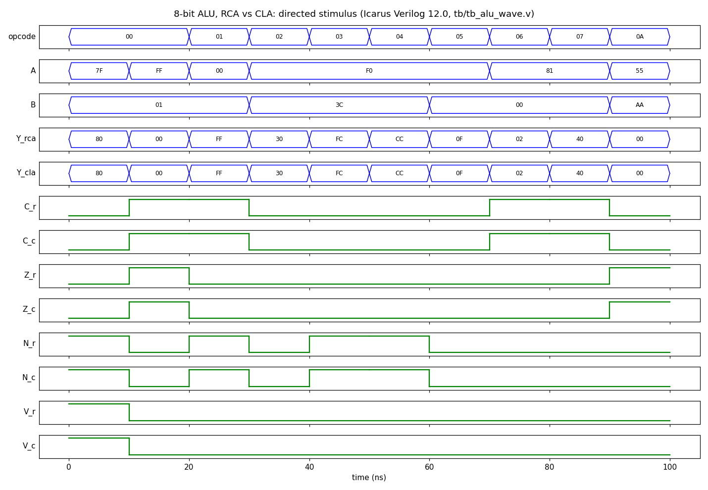

# Design and PPA Analysis of an 8-bit ALU Using Ripple-Carry and Carry-Lookahead Architectures

## Overview

This project implements two functionally equivalent 8-bit Arithmetic Logic Units (ALUs) in Verilog:

- **`alu_rca`** uses a structural Ripple-Carry Adder (RCA).
- **`alu_cla`** uses a Carry-Lookahead Adder (CLA).

Both ALUs support the same operations and status flags. The project focuses on modular RTL design, simulation-based verification, and synthesis-based comparison of the architectures.

## Operations

| Opcode | Operation | Notes |
|---|---|---|
| `0000` | Addition (`A + B`) | Carry = carry-out; Overflow = signed overflow |
| `0001` | Subtraction (`A - B`) | Carry flag indicates unsigned borrow |
| `0010` | Bitwise AND | `A & B` |
| `0011` | Bitwise OR | `A \| B` |
| `0100` | Bitwise XOR | `A ^ B` |
| `0101` | Bitwise NOT A | `~A` |
| `0110` | Logical left shift A by 1 | Carry = bit shifted out |
| `0111` | Logical right shift A by 1 | Carry = bit shifted out |
| `1000`–`1111` | Reserved | Expected result `Y = 0`; Zero = 1; other flags = 0 |

### Status flags

- **Zero:** set when the result is `0x00`.
- **Negative:** reflects the most significant bit of the result.
- **Carry:** arithmetic carry/borrow or the bit shifted out; zero for logical operations and reserved opcodes.
- **Overflow:** signed two's-complement overflow for addition/subtraction; zero for non-arithmetic operations.

## Architecture

### Ripple-Carry Adder

Eight full-adder stages are connected in series, with each carry feeding the next stage. It has a simple, regular structure, but carry propagation can create a longer logic path as width increases.

### Carry-Lookahead Adder

Generate and propagate signals are used to calculate carries with expanded lookahead equations. This can reduce logic depth at the cost of additional logic resources. Actual performance depends on the synthesis flow, technology, and timing constraints.

Both ALUs instantiate separate adder units for addition and subtraction to keep the implementation comparison consistent.

## Project Structure

```text
8bit-alu-architecture-comparison/
├── rtl/
│   ├── full_adder.v
│   ├── ripple_carry_adder.v
│   ├── carry_lookahead_adder.v
│   ├── alu_rca.v
│   └── alu_cla.v
├── tb/
│   └── tb_alu_comparison.v
├── tb/
│   └── tb_alu_wave.v
├── sim/
│   ├── run_simulation.bat
│   ├── run_simulation.sh
│   └── vcd_to_png.py
├── docs/
│   └── alu_waveform.png
├── synthesis/
│   └── run_synthesis.ys
├── reports/
│   ├── alu_comparison_results.txt
│   ├── sim_log.txt
│   ├── alu_rca_synthesis.log
│   └── alu_cla_synthesis.log
└── README.md
```

## Simulation and Verification

The self-checking testbench includes a behavioral reference model and checks the RCA and CLA outputs/flags against it. Its planned coverage includes arithmetic boundary cases, signed overflow, logical operations, shifts, all 16 opcodes, and reproducible randomized inputs.

The testbench runs 538 checks (32 all-opcode checks, 12 directed corner cases and 494 seeded randomized checks). A local run with Icarus Verilog 12.0 on 21 Oct 2026 reported **538 checks, 0 failures, `ALL TESTS PASSED`**; the full output is in [`reports/sim_log.txt`](reports/sim_log.txt). Re-run the script after any RTL or testbench change.



The waveform above comes from `tb/tb_alu_wave.v`, a short directed stimulus used only for viewing (it covers signed overflow, carry-out, borrow, every logic and shift op, and one reserved opcode). It was converted from VCD to PNG with `sim/vcd_to_png.py`.

### Run on Linux / macOS

Requires Icarus Verilog, Yosys and Python 3 with matplotlib. From the repository root:

```sh
# 1. Self-checking simulation (538 checks)
sh sim/run_simulation.sh

# 2. Generic synthesis of both ALUs (writes reports/alu_rca_synthesis.log and reports/alu_cla_synthesis.log)
yosys -q -s synthesis/run_synthesis.ys

# 3. Waveform: VCD from the directed testbench, then PNG
iverilog -o sim/alu_wave.vvp rtl/full_adder.v rtl/ripple_carry_adder.v rtl/carry_lookahead_adder.v rtl/alu_rca.v rtl/alu_cla.v tb/tb_alu_wave.v
vvp sim/alu_wave.vvp
python3 sim/vcd_to_png.py   # writes docs/alu_waveform.png
```

### Run on Windows

1. Install Icarus Verilog and ensure `iverilog` and `vvp` are available in PATH.
2. From the project root, run:

   ```bat
   sim\run_simulation.bat
   ```

A successful run should show zero failures and `ALL TESTS PASSED`.

## Generic Synthesis Comparison

The table below comes from running `synthesis/run_synthesis.ys` unchanged with **Yosys 0.52** on 21 Oct 2026. The flow is generic `synth -flatten` with internal ABC gate mapping, followed by `check`, `stat` and `ltp -noff`. The logs are in [`reports/alu_rca_synthesis.log`](reports/alu_rca_synthesis.log) and [`reports/alu_cla_synthesis.log`](reports/alu_cla_synthesis.log).

| Metric (Yosys 0.52) | RCA ALU | CLA ALU |
|---|---:|---:|
| Total cells reported by `stat` | 391 | 469 |
| of which `$scopeinfo` (non-logic hierarchy markers) | 18 | 2 |
| Generic logic gate cells | 373 | 467 |
| Longest topological path (`ltp -noff`) | 28 | 18 |
| Wires | 415 | 472 |
| Problems reported by `check` | 0 | 0 |

The longest topological path drops from 28 to 18 levels, about 35.7%:

\[
\frac{28-18}{28}\times100\approx35.7\%
\]

**Historical: log not available, not reproduced.** An earlier Yosys 0.33 run recorded 287 vs 398 generic mapped cells, 29 vs 19 levels and 342 vs 411 wires. No log from that run exists and the numbers were not reproduced here, so treat them as unverified. They point the same way as the 0.52 run (CLA: more cells, shorter path).

In both runs, the CLA used more generic mapped logic cells but had a shorter reported topological path. These metrics describe the complete ALU implementations, not isolated adder blocks.

### Interpreting the RCA-versus-CLA Trade-off

A ripple-carry adder computes each carry from the previous stage, so the carry dependency can extend through the 8-bit datapath. A carry-lookahead adder computes carries using generate/propagate relationships, reducing the dependency depth at the expense of more logic.

That trade-off shows up in the Yosys 0.52 run: the complete CLA ALU has more generic logic cells (467 versus 373), while its reported topological path is shorter (18 versus 28 levels), a reduction of about 35.7%. This does not prove a 35.7% reduction in real circuit delay; actual timing depends on cell delays, loading, routing, and constraints.

### Limitations

- Topological logic depth is not propagation delay in nanoseconds.
- Generic mapped cell count is not physical silicon area.
- Power has not been measured.
- Physical PPA requires an appropriate target-cell library, constraints, and technology-specific implementation/timing analysis.
- Exact generic counts and logic-depth values vary with Yosys/ABC version (0.33 and 0.52 give different numbers, as shown above).

Details are in `reports/alu_comparison_results.txt`.

## Running the Yosys Script

With Yosys installed, run from the repository root:

```bash
yosys -s synthesis/run_synthesis.ys
```

## Key Takeaways

- Implemented two 8-bit ALU architectures with the same operation set and status flags.
- The self-checking simulation passed 538 of 538 checks (log committed).
- The generic synthesis comparison shows a resource-versus-logic-depth trade-off: CLA uses more generic logic cells but has a shorter reported topological path.
- Generic synthesis statistics do not establish physical area, power, or delay in nanoseconds.

## Physical PPA: Scope and Measurement Plan

The current results are **generic synthesis statistics**, not physical PPA results. No numerical physical area, power, or propagation-delay values are claimed in this project yet.

To make a technology-specific comparison in a future iteration:

1. Select a compatible standard-cell library and process corner.
2. Define consistent timing constraints, including the clock/required path assumptions and input/output delays appropriate to the design.
3. Synthesize both ALUs using the same tool, library, constraints, and optimization settings.
4. Run static timing analysis and compare the critical-path delay in nanoseconds.
5. Use a comparable physical-design flow for cell area and, where supported by suitable activity and load assumptions, power estimation.
6. Record tool versions, constraints, library details, and both designs' reports so the comparison is reproducible.

Until those steps are completed, leave physical area, power, and delay fields unreported rather than estimating them from generic cell counts or logic levels.

## Future Work

- Add a technology-specific cell library and perform static timing analysis.
- Compare physical area and power using a suitable implementation flow.
- Explore hierarchical lookahead structures and wider ALUs.

## Resume / LinkedIn Description

Designed an 8-bit ALU in Verilog using Ripple-Carry and Carry-Lookahead adder architectures. Developed modular RTL and a self-checking testbench for arithmetic, logical, shift, and status-flag behavior. Compared generic Yosys synthesis results to study logic-resource and topological-depth trade-offs.

## License

Student project for educational and portfolio demonstration. No licence specified.
